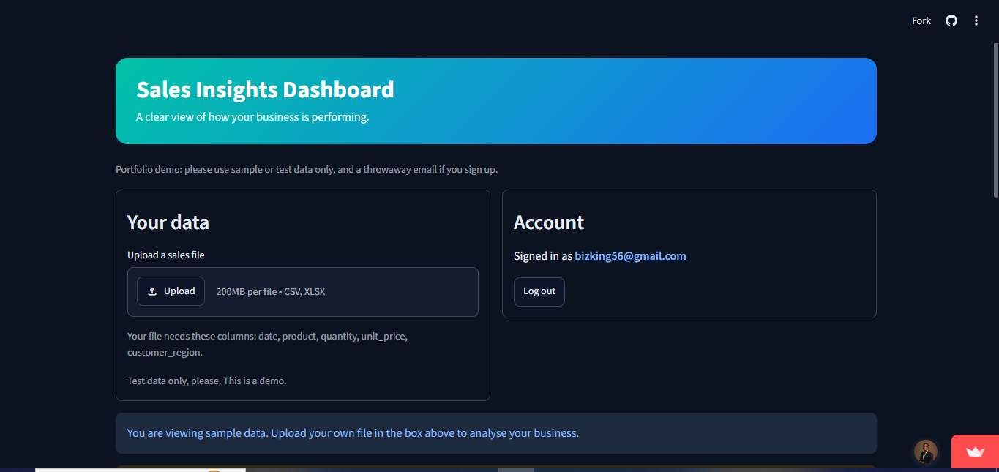
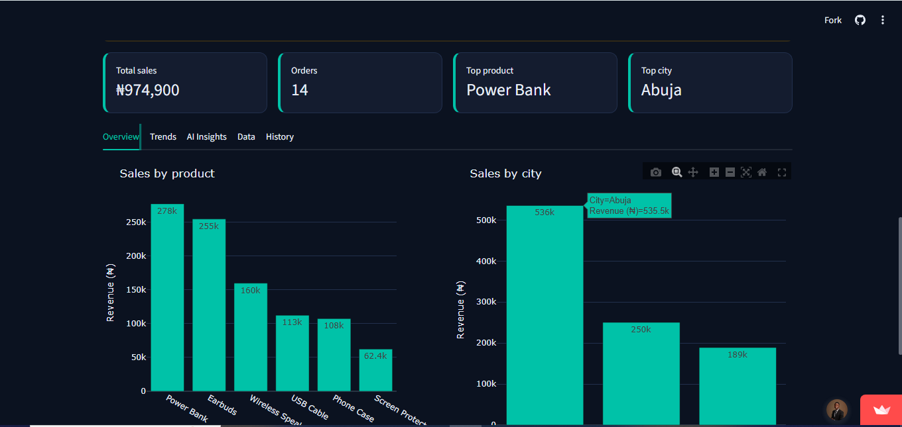
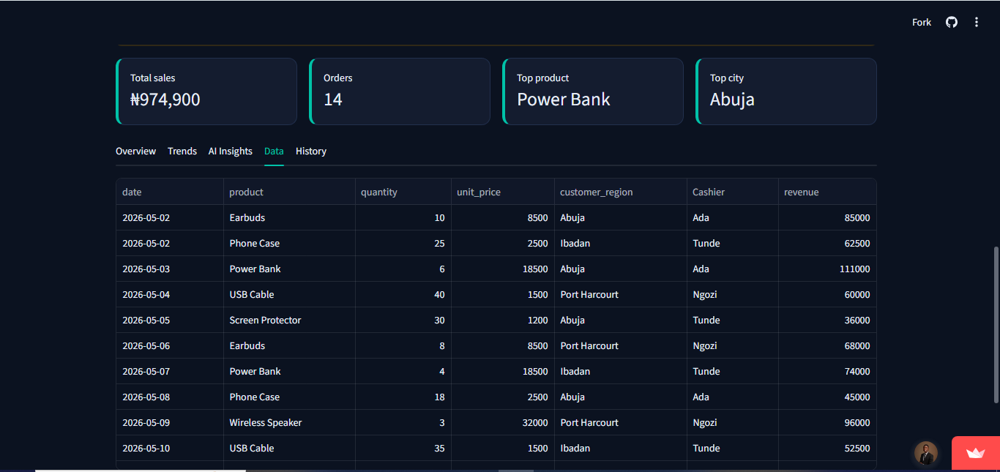
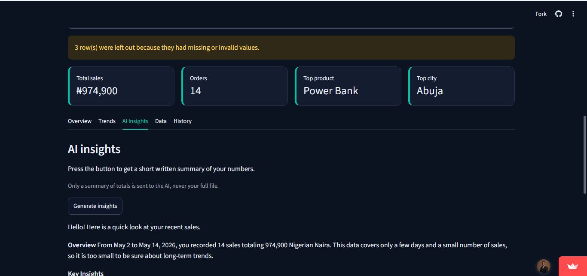
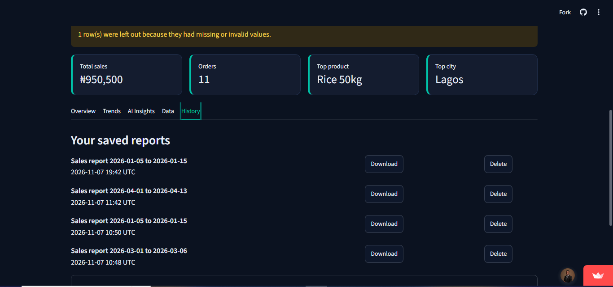
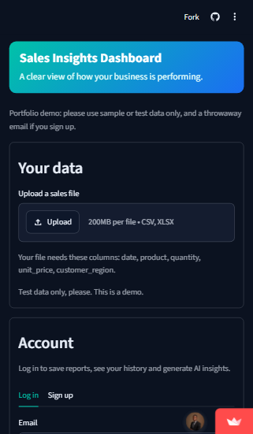

# AI Business Data Analyst

A web app that turns a sales spreadsheet into a clear dashboard, interactive charts and plain-language insights written by an AI.

**Live demo:** https://sales-insights-ng.streamlit.app/

> The demo is on a free host, so if nobody has used it for a while it may take about a minute to wake up. Screenshots are below.



## What it does

- Reads sales data from **CSV or Excel** files
- Checks the file for the columns it needs, and lets the user **match different column names** (for example "Qty" to "quantity")
- Cleans the data and tells the user how many rows were left out
- Shows **total sales, number of orders, top product and top city**
- Draws **interactive charts**: sales by product, sales by city, and sales day by day
- Lets signed-in users generate a short **AI summary** of their numbers
- **Checks every number the AI writes** against the figures calculated in Python, and warns if one does not match
- Lets anyone **download a report**
- Lets signed-in users **save reports to a private history** and download or delete them later
- Works on **phones**: the layout stacks on small screens and every control is on the main page

## Screenshots

| Charts | Column matching |
|---|---|
|  |  |

| AI insights | Saved report history |
|---|---|
|  |  |

**On a phone**



## Try it yourself

1. Open the [live demo](https://sales-insights-ng.streamlit.app/).
2. Download the two sample files from the [`data`](data) folder: `shop_a_grocery.xlsx` (a clean file) and `shop_b_phones.xlsx` (a messy file with different column names and three bad rows).
3. Upload one of them with the **Upload** button. Shop B shows the column-matching step.
4. Sign up with a throwaway email to generate AI insights and save reports.

This is a portfolio demo. Please use sample data only, and a password you do not use anywhere else.

## Key design rules

**Python calculates every number. The AI only explains them.** The AI never sees the full sales file. It receives only a small summary of totals, and any number it writes that is not in that summary is flagged.

**Each user only sees their own saved reports.** Accounts and saved reports are stored in Supabase, and row level security rules let a signed-in user read, add and delete only their own rows.

## Built with

Python, Pandas, NumPy, Plotly, Streamlit, Google Gemini API, Supabase (authentication and database), pytest, Git and GitHub. Hosted on Streamlit Community Cloud.

## How it works

1. The user uploads a file, or uses the sample data.
2. `data_tools.py` checks the columns, cleans the data and calculates revenue.
3. `build_summary` calculates the key figures in Python.
4. `app.py` shows the cards and charts.
5. If the user is signed in, `ai_analyst.py` sends only the summary to the AI, then checks that every number in the reply appears in the summary.
6. `report.py` builds a downloadable report, and `auth_tools.py` can save it to the user's private history.

## Project files

| File | Purpose |
|---|---|
| `app.py` | The Streamlit web app |
| `data_tools.py` | Reading, checking and cleaning data, and building the summary |
| `ai_analyst.py` | Asks the AI for insights and checks its numbers |
| `auth_tools.py` | Sign up, log in, and saving, listing and deleting reports |
| `report.py` | Builds the downloadable report |
| `test_calculations.py` | Automated tests for the calculations |
| `.streamlit/config.toml` | Colour theme |
| `supabase_setup.sql` | Database setup |
| `data/` | Sample sales files |

## Run it locally

1. Install Python 3.13 and create a virtual environment:

   ```
   py -3.13 -m venv venv
   venv\Scripts\Activate.ps1
   ```

2. Install the requirements:

   ```
   python -m pip install -r requirements.txt
   ```

3. Create a free [Google AI Studio](https://aistudio.google.com/apikey) key and a free [Supabase](https://supabase.com) project.

4. In Supabase, open the SQL editor and run `supabase_setup.sql`.

5. Save your settings in a file called `.env` in the project folder. Never share this file or upload it to GitHub:

   ```
   GEMINI_API_KEY=your-gemini-key
   SUPABASE_URL=https://your-project-id.supabase.co
   SUPABASE_KEY=your-supabase-publishable-key
   ```

6. Start the app:

   ```
   streamlit run app.py
   ```

When the app is deployed, the same three settings go into the host's secrets settings instead of a `.env` file.

## Run the tests

```
python -m pytest -v
```

## Limitations

- The file must contain date, product, quantity, unit price and city information.
- Rows with missing or invalid values are left out.
- Short periods of data show a snapshot, not a long-term trend.
- The free Gemini tier has usage limits, and Google may use free-tier requests to improve its products. Use a paid key for real business data.
- Model names change over time. If the AI step fails with "model not found", update the model name in `ai_analyst.py`.
- This is a portfolio demo. Email confirmation is switched off in Supabase so visitors can try it quickly. A production version would use a proper email sender and confirmation.
- Saved reports contain business figures and are stored on Supabase's servers.
- Users are signed out when the page is refreshed.

## What I learned

Built while learning Python: data cleaning with Pandas, charts with Plotly, calling an AI API, protecting API keys with environment variables, user accounts and database security rules, responsive layout, testing, version control with Git, and deploying an app online.